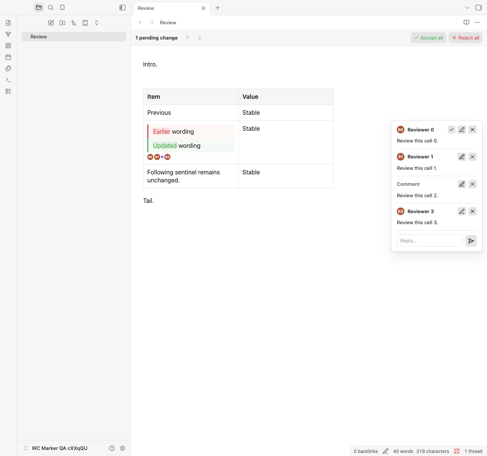
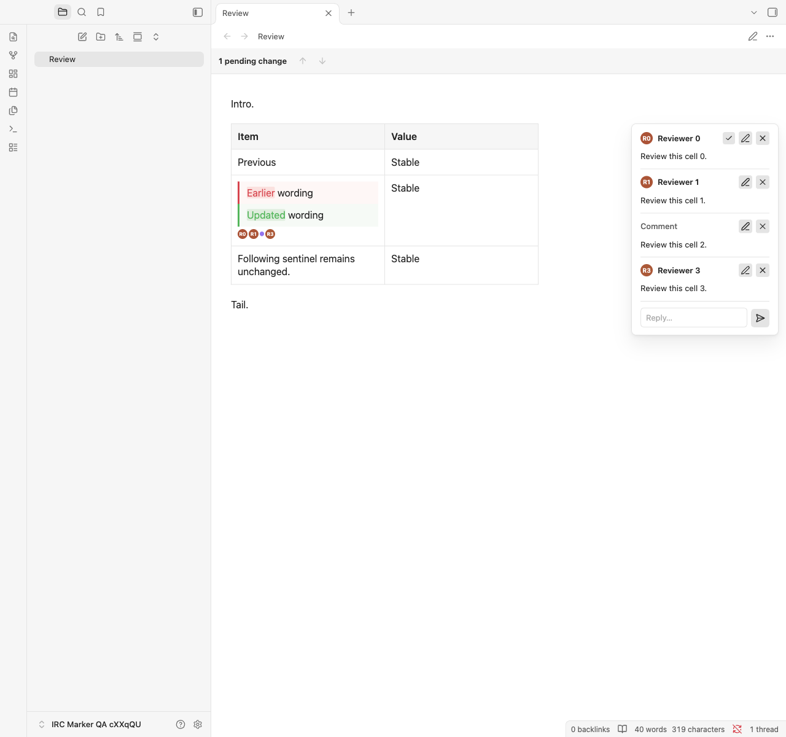
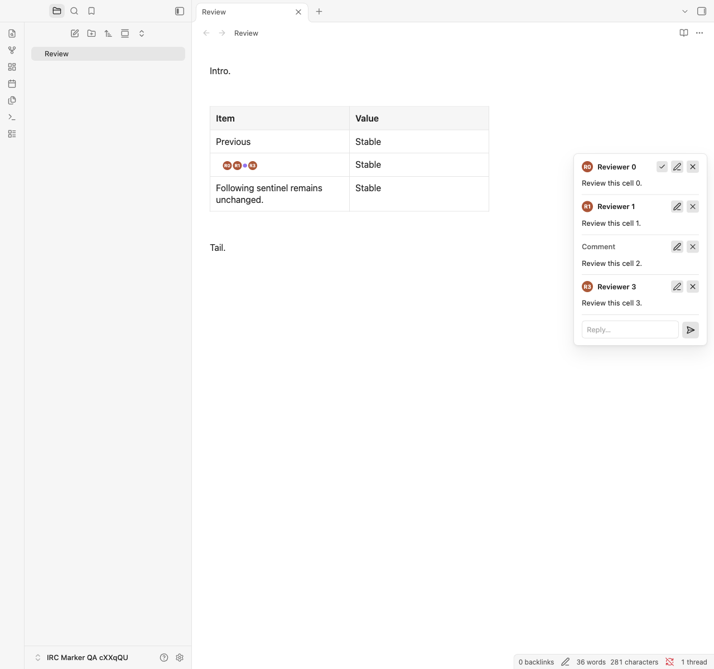

# Triage: rendered table avatars overflow into the following row

Status: **fixed; local deployment verified on 4 November 2026**. Original priority: P2 (review UI overlap; no source corruption observed). See [Fix and verification](#fix-and-verification--4-november-2026) for the tested candidate and results.

Independently re-triaged before implementation on **4 November 2026**. The defect also reproduced in native comment-only table cells with Inline Diff disabled; see the findings below.

The following reproduction and handoff sections record the investigation before implementation. At that stage only this document was added to this repository. Inline Diff's separate separator-spacing correction was completed first; the IRC fix and local deployment are recorded at the end.

## Affected builds and symptoms

Reproduced in desktop Obsidian 1.15.0 with Inline Review Comments **4.2.2** and Inline Diff **1.3.1**, including both `inline-diff:1.3.1:native-styling` and the corrected `inline-diff:1.3.1:comment-spacing` build. IRC checkout at handoff: `87b5fe2`; its code and installed assets were not changed. The integration runner verifies actual installed asset bytes rather than relying on manifest versions.

| Artifact | SHA-256 |
| --- | --- |
| IRC `main.js` | `3bbce79384c0279aac1f681c23a699e2db8ce556dd77dbe939d7a726e16e00be` |
| IRC `manifest.json` | `008d8d3ee8ec02c222e394ac40d44e06014d6e479c7a24cb9e04b1bcd39bbdf8` |
| IRC `styles.css` | `676ef90ca712762eb61d19b3b09ac941e229bff7e54bc8d9f59d73b971c96a26` |
| Earlier Inline Diff `main.js` | `60b6c6df56642a65aa25183411379ab0af263c8e0c02d8811e4dfdaf520cc29e` |
| Earlier Inline Diff `styles.css` | `9b4bd2fe4d68f7b1cbd309897ac36ba0cf565ef7ea09f84db97565434eda6128` |
| Corrected Inline Diff `main.js` | `04c32ac88c9aae7c31127ccfb7facdff6627dbb7f68bddd027054c07f12f5641` |
| Corrected Inline Diff `styles.css` | `2df637cc5ed14afaaf853f75fa596d8063becc3263007bb3d4cc8d0c037dfc53` |
| Inline Diff `manifest.json` | `66be1ba695af3c1bbb4414c0d278524165a492e79c2496fd10cf6f19add3a388` |

In Live Preview, avatars belonging to an edited table cell appear over text in the next row. The source row/cell identity is correct; rendered containment fails. Reproduces without CSS snippets and with exact/asymmetric-padding/increased-typography profiles. In the recorded fixture, avatars extend **19.2890625 CSS pixels** beyond the owning row. Following text, font, wrapping and row height remain intact, but its visible area is overlapped.

## Minimal reproduction

Enable both plugins in a disposable vault, use Live Preview, and place the caret outside this table:

```markdown
| Item | Value |
| --- | --- |
| Previous | Stable |
| {~~Earlier wording~>Updated wording~~}%% ::Reviewer A:: Review this change. %% | Stable |
| Following sentinel remains unchanged. | Stable |
```

One comment is sufficient for the overflow. For the original combined symptom, put four comments after the proposal, separated by single spaces. No agent requests, real names or personal notes are needed.

Expected: one indicator per stored comment, contained within its original cell's native content wrapper. If exact placement is ambiguous across Before/After, a cell-local fallback after the complete comparison is safe; it must not assign an existing comment to an alternative by matching displayed words.

## Root cause and owning code

- `src/marker-anchor.ts`, `markerTargets()`: table row/cell ownership is resolved from source positions. The target container is the `td`/`th`.
- `markerPoint()` in the same file compares its source-text projection with visible DOM text. CriticMarkup source and a complete rendered Before/After pair do not have identical visible text, so the exact placement fails closed and returns `null`.
- `src/rendered-markers.ts`, `RenderedMarkerManager.draw()` (approximately line 161 in 4.2.2): the fallback calls `target.container.appendChild(marker)`.
- Inline Diff now retains passive native Live Preview table hooks, including `.table-cell-wrapper`. Native CSS applies `.markdown-source-view.mod-cm6 .cm-table-widget .table-cell-wrapper { height: 100%; }`.

The result is:

```html
<td>
  <div class="table-cell-wrapper">
    <!-- complete Before/After comparison -->
  </div>
  <span class="irc-inline-avatar">...</span>
</td>
```

The avatar's anonymous line contributes to intrinsic row sizing. The wrapper then fills the allocated height, placing the subsequent avatar line outside the row. Appending to the wrapper in a disposable DOM probe removes the overlap without modifying Markdown or native CSS.

## Separate the two defects

Inline Diff also exposed whitespace left between hidden comments. Those separators can form a blank line after a block comparison, even when IRC is disabled. That correction belongs to Inline Diff and must not be reimplemented here.

In a short synthetic fixture, the original row was 136.1875px high with a 52.09375px gap below its comparison. Moving avatars inside the wrapper reduced the row to 115.390625px and kept every avatar inside the cell. With neither avatars nor separator-only text, native padding/border accounted for the remaining 10.5px gap. The following row stayed 41.796875px high throughout.

Fresh corrected-build probes confirm the remaining defect: the synthetic row measures 115.390625px with a 73.59375px comparison and 19.2890625px avatar overflow. Removing avatars reduces it to 94.59375px; moving them into the wrapper keeps the legitimate avatar line but eliminates overflow. The following row remains 41.796875px. Do not treat Inline Diff's reduced gap as resolution of this issue.

## Recommended implementation boundaries

Resolve the cell's actual content host and use it for both precise insertion and fallback, preferring a direct native `.table-cell-wrapper` when present. Preserve plain `td`/`th` behavior for Reading/HTML/render-only tables without that wrapper. Keep source-based table/row/cell ownership, existing identity and cleanup; do not move another plugin's comparison or copy/split note content.

Do not compensate with negative margins, clipping, forced cell height, changed wrapper padding or competing `!important` rules. Do not select an alternative by repeated displayed text. Native links, code, writing controls and component ownership must retain their existing behavior.

## Acceptance checks

- One/four comments; header/body cells, including comment-only cells with Inline Diff disabled; identical cell text; several proposals in one cell; comments before/after a proposal; native and review-owned tables; multiple/nested tables.
- Precise insertion when mapping succeeds and wrapper-contained fallback when it does not. Exactly one visible marker per stored comment; no duplicated markers after redraw.
- Every avatar's visible box remains inside the owning row/cell and does not intersect the following row's text (0.5 CSS-pixel tolerance).
- Source, Live Preview and Reading; no snippets and varied padding/font/line-height overrides; narrow/wide panes; light/dark themes; splits and popouts.
- Proposal accept/reject and undo/redo, comment additions/removals, native cell editing, delayed renders, mode changes and plugin reload/unload. Source bytes and unrelated content remain unchanged.
- No observer/redraw loops, stale detached markers or cross-pane ownership; preserve the existing native-render and comment tests.

## Reproducible live suite

The sibling Inline Diff repository contains `scripts/obsidian-following-content.mjs` and the `test:obsidian:following` command. From that repository:

```sh
OBSIDIAN_QA_IRC_DIR="/path/to/this/plugin/build-or-installation" \
OBSIDIAN_QA_OVERRIDE_FILE="/path/to/a/read-only/snippet.css" \
npm run test:obsidian:following -- --comments=combined
```

For a candidate fix, first run this repository's `npm run lint`, `npm test`, and `env -u OBSIDIAN_PLUGIN_DIR -u OBSIDIAN_VAULT_DIR npm run build`; the build includes both type checks. Then point `OBSIDIAN_QA_IRC_DIR` at this checkout when running the sibling diagnostic. The original handoff excluded local deployment; the subsequent implementation task explicitly authorized it after validation.

The runner copies only the three plugin assets into a sentinel-verified disposable vault; settings and agent configuration are not copied. It records following-content typography, wrapping, block/row dimensions, marker bounds, exact file bytes and undo depth. Its combined mode retains failing overflow assertions and exits nonzero until the integration is fixed. The comments-off core mode separately validates Inline Diff spacing.

Before the spacing correction, the 336-case matrix reported 16 failed cases: eight avatar-overflow cases and twelve excess-height cases, with four shared cases. The expanded corrected-build run has **408 cases: 388 pass and 20 fail**. All twenty failures are avatar overflow/overlap in Live Preview: five commented-table families (tabs, comments before a proposal, comments between two proposals, one comment and four comments), each across four override profiles. All spacing, following-content, typography, exact-byte and undo/redo checks pass; there are zero plugin/page errors. The separate comments-off run passes all 204 cases and is mandatory Inline Diff validation. The combined command intentionally exits 1. Fresh reports are `.qa/comment-spacing-core-report.json` and `.qa/comment-spacing-combined-report.json` in the sibling checkout; sanitized evidence and screenshots are linked from its `docs/comment-spacing-testing.md`. Runtime: Obsidian 1.15.0, Electron 43.8.4, Chromium 150.0.7871.250, Node 24.22.1, macOS arm64.

The original handoff did not publish an issue, modify IRC code or authorize installation/publication of a new IRC build. The later local implementation and installation are described below; remote publication remains outside this task.

## Independent triage before implementation — 4 November 2026

**Disposition at this stage: confirmed IRC containment defect; retain P2 and keep open.** The corrected Inline Diff build was running, and both plugins' installed assets matched the checkout hashes above. The affected personal note was inspected read-only through Obsidian's UI and application API; its content is not included here.

| Fresh observation | Result |
| --- | --- |
| Affected note, corrected Inline Diff build | Four avatars are direct `td` children outside the native wrapper. Each extends 18.7890625px beyond its owning row and intersects the following row's text. |
| Affected note dimensions | Owning row 156.984375px; comparison 115.1875px; following row 41.796875px. |
| Complete combined diagnostic, rerun against current assets | 408 cases: 388 pass, 20 fail. Every failure reports avatar overflow and following-text overlap; zero plugin/page errors. |
| Synthetic causal probe | 19.2890625px overflow. Moving avatars inside the wrapper removes overflow while retaining the 115.390625px row, 73.59375px comparison and 41.796875px following row. |
| Existing rendered-marker component suite | All 23 tests pass. Its table fixtures omit native `.table-cell-wrapper` elements, so they do not exercise the failing containment boundary. |

The four displayed avatars correspond to four stored comment messages in the affected cell. Their count is expected; their location causes the visual defect. Existing source-based row/cell ownership should be retained.

### Confirmed native-table scope

Inline Diff is not required. With only IRC enabled, place the caret outside this native Live Preview table:

```markdown
| Item | Value |
| --- | --- |
| %% ::Reviewer A:: Review this cell. %% | Stable |
| Following sentinel remains unchanged. | Stable |
```

An empty visible cell makes `markerPoint()` return `null` even without a comparison. The same fallback then appends the avatar after the native wrapper. A separate 12-case real-Obsidian probe checked comment-only body cells with one/four comments, a comment-only header cell, and an ordinary text/comment/text control in Source, Live Preview and Reading:

- Live Preview body cells overflow by 19.2890625px; the header cell by 19.2265625px. Their markers are direct `td`/`th` children.
- The ordinary Live Preview control maps precisely into the wrapper and has zero overflow.
- All eight Source/Reading cases have zero overflow. Reading tables have no native wrapper and correctly retain direct cell insertion.
- Every case retains the expected avatar count, exact buffer/saved bytes and zero undo/redo depth. Inline Diff remains disabled; no page errors occur.

This strengthens the implementation boundary: resolve the direct native cell-content host for both precise mapping and fallback, rather than special-casing Inline Diff. Add component regressions with actual wrapper structure, including empty body/header cells, alongside the existing combined real-app geometry assertions. Keep wrapper-free Reading/HTML tables and embedded cell-editor ownership intact.

No plugin source or styles were changed. The personal note, editor state, settings, running IRC instance and Notes installation remain unchanged; temporary plugin installations were confined to disposable test vaults. No commit, push or release was performed.

## Fix and verification — 4 November 2026

Table targets now use their direct native `.table-cell-wrapper` for both precise mapping and structural fallback. Wrapper-free tables retain `td`/`th` insertion. Source-based ownership, comment IDs/order and embedded editor ownership remain intact; native CSS and Inline Diff's comparison DOM are unchanged.

The long-scroll check also exposed cached Reading sections returning without another render-child load. The marker manager now retains weak source associations and watches the owning preview for section reattachment. Markers are restored without rerendering Markdown; preview observers, scheduled frames and owned markers are released on teardown. A regression covers delayed attachment and repeated cached reuse without another child load.

Before the containment fix, all 23 existing marker tests passed and all 21 new wrapper regressions failed. The final marker suite passes all 46 cases, and the complete automated suite passes all 244 tests. Lint, both type checks, the deployment-disabled production build, metadata validation and diff checks pass.

| Final real-Obsidian suite | Result |
| --- | --- |
| Default theme: all fixture families, three modes, four CSS profiles, light/dark, narrow/wide, IRC alone/combined | 960 passed |
| Primary, Minimal and Blue Topaz: representative native/header/proposal fixtures, both palettes and widths | 72 passed |
| Splits/popouts, zoom, runtime CSS, reload/unload, native cell/comment editing and virtualized scroll/return | 9 passed |
| Sibling combined following-content diagnostic | 408 passed; previously 20 overflow failures |
| Sibling comments-off control | 204 passed |
| Total real-app cases | **1,653 passed; zero failures or plugin/page errors** |

The IRC-owned runner is `npm run test:obsidian:markers`; its read-only inputs and focused rerun options are documented in the README. It creates a sentinel-verified disposable vault and copies only plugin assets, synthetic fixtures and the requested CSS/themes. Plugin settings and agent configuration are excluded. Reports remain in ignored `.qa/`; the [sanitized machine-readable evidence](avatar-containment-test-evidence.json) records every final case, runtime and asset hashes. The real-app runtime was Obsidian 1.15.0; these results do not establish minimum-version or mobile-device validation.

The exact current Notes overrides were verified against the test input before deployment. The existing IRC installation was backed up outside the vault; only `main.js`, `manifest.json` and `styles.css` were replaced, and only IRC was reloaded. The installed assets match the tested candidate byte for byte. No jobs or unsaved drafts were active.

On the existing pending proposal, all four avatars are inside their original cell. Overflow fell from 18.7890625px to **0px**, with no following-text intersection. Note bytes, comments, pending counts, selections, undo/redo history, settings, snippets, other running plugin instances, Inline Diff assets and comparison/following-row presentation passed preservation checks. Native UI inspection confirmed the result; the original view was restored.

| Fixed local asset | SHA-256 |
| --- | --- |
| `main.js` | `4f5130d34a431b2277f8b9315d7873ba78f98c948cf943be9d6ab82343d2dc2c` |
| `manifest.json` | `008d8d3ee8ec02c222e394ac40d44e06014d6e479c7a24cb9e04b1bcd39bbdf8` |
| `styles.css` | `676ef90ca712762eb61d19b3b09ac941e229bff7e54bc8d9f59d73b971c96a26` |

The measurements and hashes above describe the validated local 4.2.2 candidate before publication. Release automation owns the published version and versioned manifest; the test evidence retains the exact assets exercised during validation.

Reviewed synthetic Live Preview and Reading screenshots:






